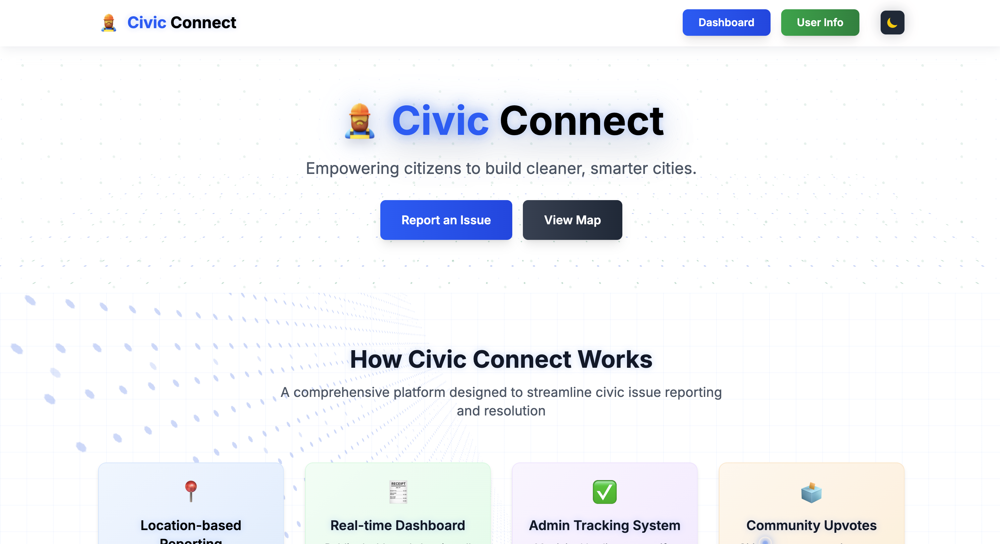
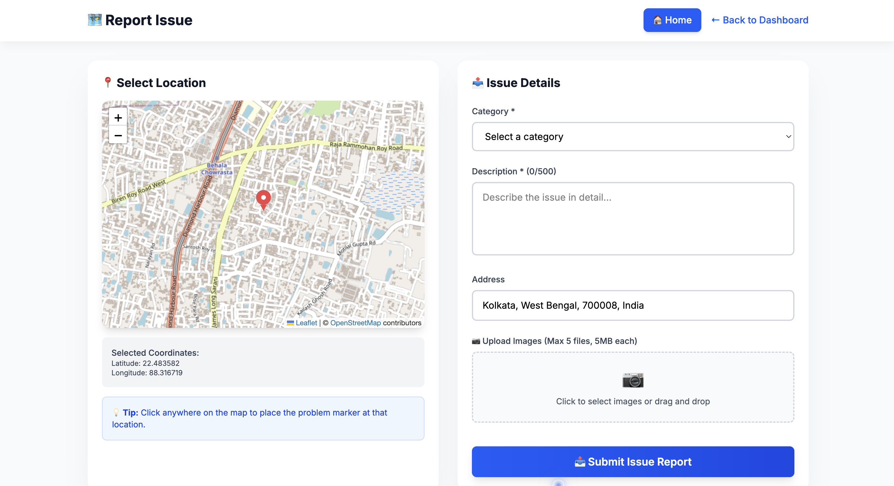
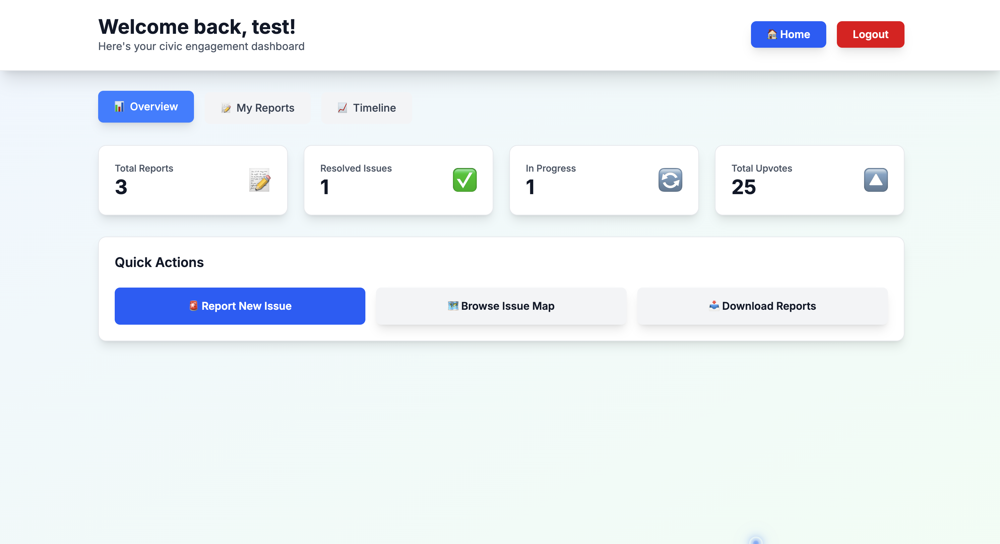
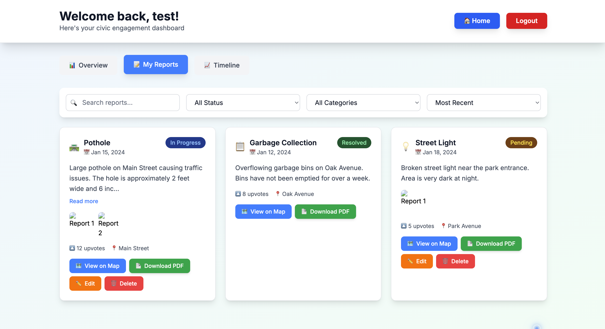
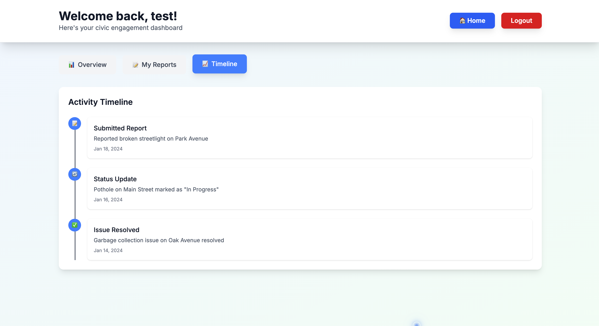
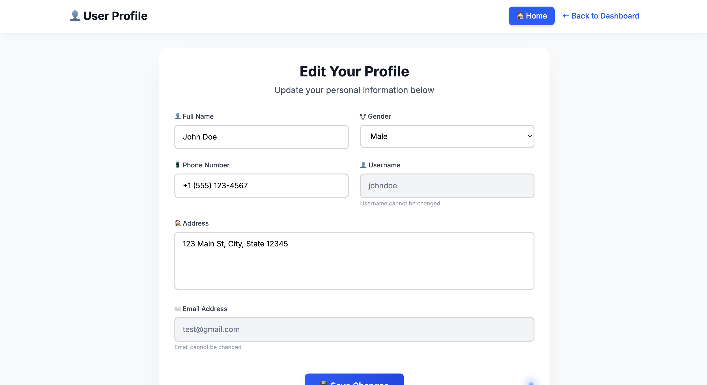

# 🏙️ Local Civic Issue Reporter & Resolver Platform(Under Progress)

<div align="center">
  
  <h3>Empowering citizens to build cleaner, smarter cities through technology and community collaboration.</h3>
  
  [](https://reactjs.org/)
  [](https://nodejs.org/)
  [](https://www.mongodb.com/)
  [](https://tailwindcss.com/)
  [](https://opensource.org/licenses/MIT)
</div>

---

## 📝 Overview

**Civic Connect** is a modern, full-stack web application that revolutionizes how citizens report and resolve local civic issues. From potholes and garbage collection to street lighting and drainage problems, our platform provides an intuitive interface for community engagement with local authorities.

### 🎯 Key Highlights
- **Interactive Map Integration** with real-time location detection
- **Comprehensive Issue Reporting** with image uploads and GPS coordinates
- **Professional PDF Report Generation** for official documentation
- **Advanced Dashboard** with analytics and issue management
- **Responsive Design** that works seamlessly across all devices
- **Dark/Light Mode** with global theme synchronization

---

## 🚀 Features

### 🔐 **Authentication & Security**
- **JWT-based Authentication** with secure token management
- **Protected Routes** and role-based access control
- **Password Encryption** using bcrypt with 12 salt rounds
- **Session Persistence** with automatic token refresh

### 🗺️ **Interactive Map System**
- **Real-time Location Detection** using Geolocation API
- **Interactive Leaflet.js Maps** with custom markers
- **Marker Clustering** for better performance with many issues
- **Reverse Geocoding** for automatic address population
- **Color-coded Issue Status** (Pending, In Progress, Resolved)

### 📋 **Issue Reporting & Management**
- **Comprehensive Report Form** with 10+ predefined categories
- **Image Upload System** (up to 5 images, 5MB each)
- **GPS Coordinate Capture** with precise location mapping
- **Issue Status Tracking** with real-time updates
- **Upvoting System** for community prioritization

### 📊 **Advanced Dashboard**
- **Tabbed Navigation** (Overview, My Reports, Timeline)
- **Dynamic Statistics** with issue count and resolution rates
- **Interactive Report Cards** with detailed information
- **Advanced Filtering** by status, category, and search terms
- **Timeline View** of user activities and submissions

### 📄 **PDF Report Generation**
- **Professional PDF Export** using jsPDF
- **Detailed Report Information** including images and coordinates
- **Branded Document Headers** with official formatting
- **Downloadable Reports** for offline viewing and submission

### 🎨 **UI/UX Excellence**
- **Responsive Design** optimized for mobile, tablet, and desktop
- **Global Theme System** with synchronized dark/light modes
- **Framer Motion Animations** for smooth transitions
- **Custom Cursor Effects** with interactive elements
- **Toast Notifications** for user feedback

---

## 🛠️ Tech Stack

### **Frontend**
| Technology | Version | Purpose |
|------------|---------|---------|
|  | **React** | UI library with hooks and context |
|  | **Tailwind CSS** | Utility-first styling framework |
|  | **React Router DOM** | Client-side routing |
|  | **Leaflet.js** | Interactive maps |
|  | **Framer Motion** | Animation library |
|  | **jsPDF** | PDF generation |

### **Backend**
| Technology | Version | Purpose |
|------------|---------|---------|
|  | **Node.js** | Runtime environment |
|  | **Express.js** | Web application framework |
|  | **MongoDB** | NoSQL database |
|  | **Mongoose** | MongoDB ODM |
|  | **JSON Web Tokens** | Authentication |
|  | **Multer** | File upload handling |

### **Development Tools**
| Technology | Version | Purpose |
|------------|---------|---------|
|  | **Vite** | Build tool and dev server |
|  | **ESLint** | Code linting |
|  | **Concurrently** | Run multiple scripts |

---

## 📁 Project Structure

```
civic-connect/
├── 📁 public/
│   ├── civic-icon.png              # App icon/logo
│   └── vite.svg                   # Vite logo
├── 📁 server/
│   └── server.js                  # Express server with all API routes
├── 📁 src/
│   ├── 📁 components/
│   │   ├── AuthModal.jsx          # Authentication modal
│   │   ├── CustomCursor.jsx       # Animated cursor component
│   │   ├── Dashboard.jsx          # Main dashboard with tabs
│   │   ├── Login.jsx              # Login form
│   │   ├── Register.jsx           # Registration form
│   │   ├── ReportIssuePage.jsx    # Issue reporting with map
│   │   └── UserInfoPage.jsx       # User profile management
│   ├── 📁 contexts/
│   │   └── AuthContext.jsx        # Authentication state management
│   ├── 📁 hooks/
│   │   └── useTheme.js            # Global theme management
│   ├── App.jsx                    # Main app component
│   ├── App.css                    # Custom styles and animations
│   ├── index.css                  # Global styles
│   └── main.jsx                   # App entry point
├── 📁 uploads/                    # Server-side image storage
├── .env                           # Environment variables
├── package.json                   # Dependencies and scripts
├── tailwind.config.js             # Tailwind configuration
├── vite.config.js                 # Vite configuration
└── README.md                      # Project documentation
```

---

## ⚡ Installation & Setup

### **Prerequisites**
Before you begin, ensure you have the following installed:
-  **Node.js** (v18 or higher)
-  **npm** (v9 or higher)
-  **MongoDB** (local or cloud instance)

### **Step 1: Clone the Repository**
```bash
git clone https://github.com/yourusername/civic-connect.git
cd civic-connect
```

### **Step 2: Install Dependencies**
```bash
npm install
```

### **Step 3: Environment Configuration**
Create a `.env` file in the root directory:

```env
# Server Configuration
PORT=3001
JWT_SECRET=your-super-secret-jwt-key-change-this-in-production-environment-12345

# Database Configuration
MONGODB_URI=mongodb://localhost:27017/CivicConnect

# Client Configuration
VITE_API_URL=http://localhost:3001/api
```

> ⚠️ **Security Note**: Change the `JWT_SECRET` to a strong, unique secret in production!

### **Step 4: Database Setup**

#### **Local MongoDB Installation:**

**macOS (using Homebrew):**
```bash
brew tap mongodb/brew
brew install mongodb-community
brew services start mongodb/brew/mongodb-community
```

**Windows:**
1. Download MongoDB Community Server from [mongodb.com](https://www.mongodb.com/try/download/community)
2. Follow the installation wizard
3. Start MongoDB service from Services app

**Linux (Ubuntu/Debian):**
```bash
sudo apt-get update
sudo apt-get install mongodb
sudo systemctl start mongodb
sudo systemctl enable mongodb
```

### **Step 5: Create Upload Directory**
```bash
mkdir uploads
```

---

## 🚀 Running the Application

### **Option 1: Start Both Frontend & Backend (Recommended)**
```bash
npm run dev:full
```

### **Option 2: Start Separately**

**Terminal 1 (Backend Server):**
```bash
npm run dev:server
```

**Terminal 2 (Frontend):**
```bash
npm run dev
```

### **Access the Application**
- 🌐 **Frontend**: http://localhost:5173
- 🔧 **Backend API**: http://localhost:3001/api

---

## 📖 Usage Guide

### **1. User Registration & Login**
1. Click **"Sign Up"** to create a new account
2. Fill out the registration form with valid email and password
3. Login with your credentials to access the dashboard

### **2. Report an Issue**
1. Navigate to **"Report Issue"** from the dashboard
2. Allow location access for automatic positioning
3. Click on the map to place a marker at the problem location
4. Fill out the form:
   - Select issue category (Pothole, Garbage, Street Light, etc.)
   - Add detailed description (max 500 characters)
   - Upload up to 5 images (5MB each)
   - Address is auto-populated via reverse geocoding
5. Submit the report

### **3. View & Manage Issues**
1. **Dashboard Overview**: See your statistics and recent activities
2. **My Reports**: View all your submitted issues with filtering options
3. **Timeline**: Track your engagement and issue resolution progress
4. **Browse Map**: View all community issues on an interactive map

### **4. Download Reports**
1. Go to **"My Reports"** tab in the dashboard
2. Click **"Download PDF"** on any issue card
3. Professional PDF report will be generated and downloaded

---

## 🧪 API Documentation

### **Authentication Endpoints**

#### **Register User**
```http
POST /api/auth/register
Content-Type: application/json

{
  "email": "user@example.com",
  "password": "securePassword123",
  "fullName": "John Doe"
}
```

#### **Login User**
```http
POST /api/auth/login
Content-Type: application/json

{
  "email": "user@example.com",
  "password": "securePassword123"
}
```

### **Issue Management Endpoints**

#### **Create Issue**
```http
POST /api/issues
Authorization: Bearer <token>
Content-Type: multipart/form-data

{
  "category": "Pothole",
  "description": "Large pothole on Main Street",
  "latitude": 40.7128,
  "longitude": -74.0060,
  "address": "123 Main St, New York, NY",
  "images": [<file1>, <file2>]
}
```

#### **Get All Issues**
```http
GET /api/issues
Authorization: Bearer <token>
```

#### **Get User Issues**
```http
GET /api/issues/my
Authorization: Bearer <token>
```

#### **Upvote Issue**
```http
POST /api/issues/:id/upvote
Authorization: Bearer <token>
```

### **User Management Endpoints**

#### **Get User Profile**
```http
GET /api/users/profile
Authorization: Bearer <token>
```

#### **Update User Profile**
```http
PUT /api/users/profile
Authorization: Bearer <token>
Content-Type: application/json

{
  "fullName": "Jane Doe",
  "phone": "+1234567890",
  "address": "456 Oak Ave, City, State"
}
```

---

## 🖼️ Screenshots

### **Landing Page**

*Modern hero section with animated elements and smooth transitions*

### **Issue Reporting**

*Interactive map with location detection and comprehensive issue reporting form*

### **Dashboard**

*Main dashboard with statistics and issue overview*


*My Reports section with filtering and management options*


*Timeline view showing user activities and issue progress*

### **User Info**

*User profile management with comprehensive information editing*


---

## 💡 Future Improvements

### **Phase 1: Enhanced Features**
- [ ] **Push Notifications** for issue status updates
- [ ] **Email Notifications** for important events
- [ ] **Admin Dashboard** for municipal authorities
- [ ] **Issue Assignment** system for departments

### **Phase 2: Advanced Functionality**
- [ ] **PWA Support** for offline usage
- [ ] **Real-time Chat** between citizens and authorities
- [ ] **AI-powered Issue Categorization** using machine learning
- [ ] **Geofencing** for location-based notifications

### **Phase 3: Platform Expansion**
- [ ] **Mobile Apps** for iOS and Android
- [ ] **Multi-language Support** for diverse communities
- [ ] **Integration APIs** for third-party municipal systems
- [ ] **Advanced Analytics** dashboard with reporting

---

## 🤝 Contributing

We welcome contributions from the community! Here's how you can help:

### **Getting Started**
1. Fork the repository
2. Create a feature branch: `git checkout -b feature/amazing-feature`
3. Make your changes and commit: `git commit -m 'Add amazing feature'`
4. Push to the branch: `git push origin feature/amazing-feature`
5. Open a Pull Request

### **Contribution Guidelines**
- Follow the existing code style and conventions
- Write clear, descriptive commit messages
- Add tests for new features
- Update documentation as needed
- Ensure all tests pass before submitting


---

## 🐛 Bug Reports & Feature Requests

### **Reporting Bugs**
If you find a bug, please create an issue with:
- Clear description of the problem
- Steps to reproduce
- Expected vs actual behavior
- Screenshots (if applicable)
- Environment details (OS, browser, etc.)

### **Feature Requests**
For new features, please include:
- Detailed description of the feature
- Use case and benefits
- Possible implementation approach
- Any relevant mockups or examples

---

## 📃 License

This project is licensed under the **MIT License** - see the [LICENSE](LICENSE) file for details.

```
MIT License

Copyright (c) 2024 Civic Connect

Permission is hereby granted, free of charge, to any person obtaining a copy
of this software and associated documentation files (the "Software"), to deal
in the Software without restriction, including without limitation the rights
to use, copy, modify, merge, publish, distribute, sublicense, and/or sell
copies of the Software, and to permit persons to whom the Software is
furnished to do so, subject to the following conditions:

The above copyright notice and this permission notice shall be included in all
copies or substantial portions of the Software.
```

---

## 📬 Contact & Support

### **Author**
- **Name**: Shantanu Beniwal
- **Email**: beniwalhappy07@gmail.com
- **LinkedIn**: https://www.linkedin.com/in/shantanu-beniwal-5973332a7


---

## 🌟 Acknowledgments

Special thanks to:
- **OpenStreetMap** for providing free map data
- **Leaflet.js** community for excellent mapping libraries
- **React** team for the amazing framework
- **Tailwind CSS** for the utility-first CSS framework
- **MongoDB** for the flexible database solution
- **All contributors** who help improve this project

---

<div align="center">
  <h3>🚀 Built with ❤️ for better communities</h3>
  <p>
    <a href="#-overview">Overview</a> •
    <a href="#-features">Features</a> •
    <a href="#-tech-stack">Tech Stack</a> •
    <a href="#-installation--setup">Installation</a> •
    <a href="#-api-documentation">API Docs</a> •
    <a href="#-contributing">Contributing</a>
  </p>
</div>

---